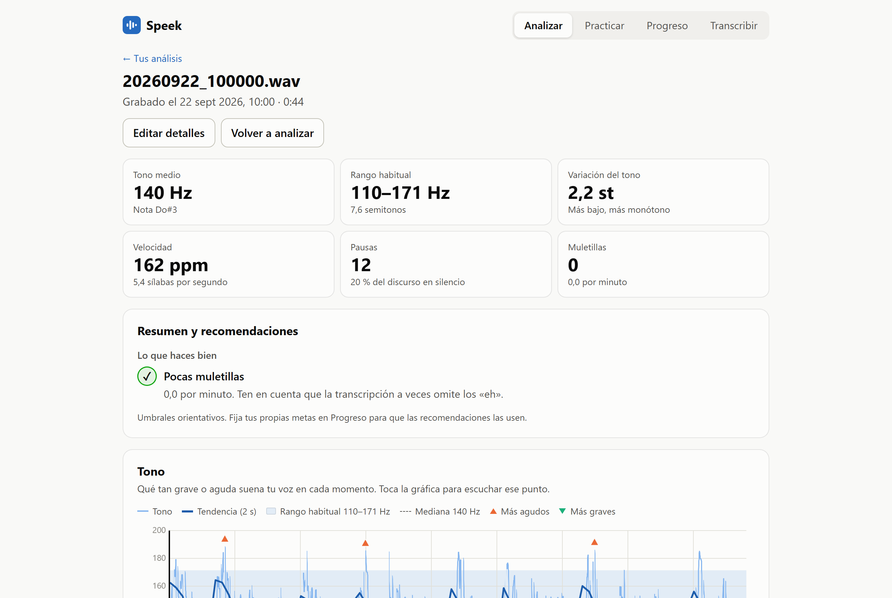
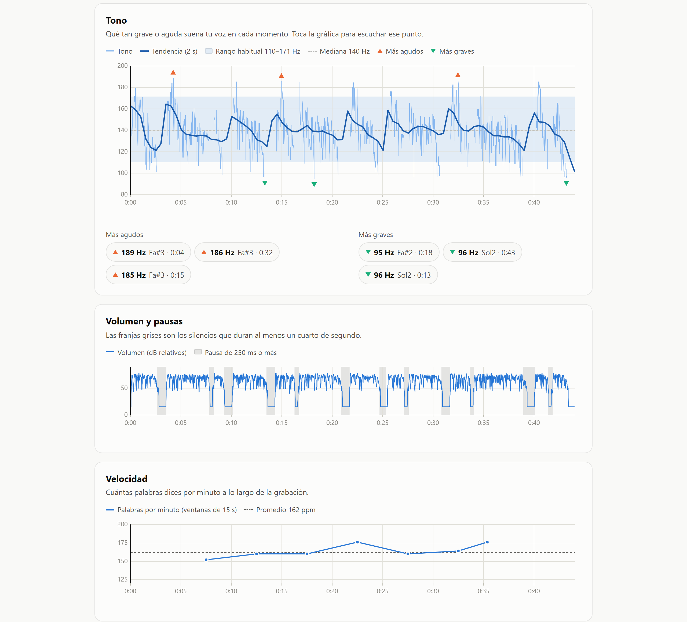
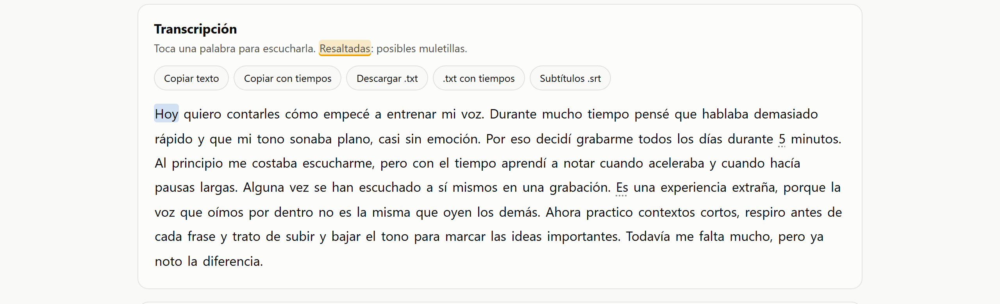
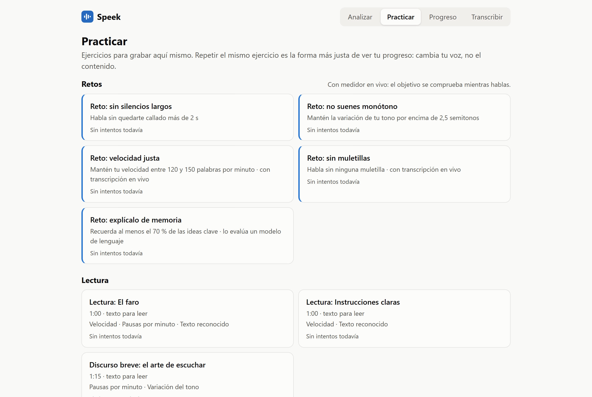

# 🎙️ Speek control — Entrena tu voz con datos

> Herramienta que analiza una grabación de voz y mide **tono, ritmo, pausas y muletillas**, para
> comparar tu progreso sesión a sesión. **Todo se procesa en local: el audio no sale del equipo.**

`Python` · `FastAPI` · `faster-whisper` · `Praat` · `React 19` · `TypeScript` · `uPlot` · `SQLite`

> **Problem:** People who want to speak better judge themselves by ear, and apps that measure voice upload recordings to the cloud.  
> **Solution:** Speek turns a recording into comparable metrics (pitch, pace, pauses, filler words) and trains you against them, 100% locally.  
> **Stack:** Python, FastAPI, faster-whisper, Praat, React 19, TypeScript, SQLite.  
> **Live demo:** None (runs locally; a walkthrough is available on request).  
> **My role:** Solo project, end to end: audio analysis, API, UI and tests, working with an AI assistant under written conventions.

*Capturas tomadas con una grabación de voz sintética: no hay voces ni datos reales.*

---

## El problema
Quien quiere hablar mejor (presentaciones, entrevistas, clases) suele guiarse por cómo se escucha, y
eso engaña: no hay forma de saber si hablas más rápido que hace un mes o si tu tono se ha vuelto más
plano. Las apps que lo miden suben el audio a la nube, y una grabación de tu voz es un dato personal.

## La solución
Speek convierte una grabación en métricas comparables y te hace practicar contra ellas:

- **📊 Informe por grabación:** tono medio, rango habitual, variación en semitonos, palabras por
  minuto, pausas y muletillas, con recomendaciones. Al tocar una gráfica o una palabra, el audio
  salta a ese momento.
- **📈 Progreso:** la última sesión frente a tu promedio, una gráfica por métrica y metas propias.
- **🏋️ Práctica guiada:** ejercicios de lectura, entonación, dicción y habla libre, para repetir el
  mismo contenido y comparar de forma justa.
- **⏱️ Retos con marcador en vivo:** sin silencios largos, sin monotonía, velocidad justa, sin
  muletillas (con transcripción en vivo) y explicar un texto de memoria.
- **📝 Transcribir en lote:** varios audios a la vez, exportables a `.txt`, `.srt` o un `.zip`.

## Capturas

| | |
|---|---|
|  |  |
| *Tono, pausas y velocidad sincronizados con el audio.* | *Transcripción tocable y exportable.* |

## Decisiones técnicas destacadas
- **Todo local por diseño.** Praat (vía `parselmouth`) para el tono y faster-whisper en CPU para la
  transcripción: sin GPU, sin servicios externos y sin cuentas. FFmpeg no hace falta (PyAV).
- **Transcripción en vivo con dos vueltas.** Un WebSocket manda el audio al servidor, que transcribe
  con un modelo más liviano; las palabras salen en gris y se confirman a los 3–4 s. Hay guardas
  contra el texto inventado que Whisper produce con ruido de fondo.
- **Comparabilidad antes que cantidad de métricas.** Los ejercicios fijos, la marca de «grabación con
  ruido de fondo» y el filtro por tipo de ejercicio existen para que dos sesiones se puedan comparar
  de verdad.
- **Modelo de lenguaje intercambiable.** El reto de memoria lo evalúa Ollama (privado, gratis, 2–3
  minutos en un portátil sin GPU) o la API de Claude (segundos, centavos de dólar); solo viaja el
  texto de la explicación, nunca el audio. Se cambia en un `.env` sin reiniciar. En pruebas, los
  modelos pequeños daban por dichas ideas que faltaban, así que no se recomiendan para evaluar.
- **Formatos reconocidos por contenido,** no por extensión (el celular entrega `.aac`, `.ogg`,
  `.m4a`…), con la fecha de grabación sacada del nombre del archivo o de sus metadatos.
- **HTTPS local para grabar desde el celular,** porque el navegador solo da el micrófono en contextos
  seguros; con respaldo de copiado donde no hay portapapeles seguro.

## Números del repositorio
136 pruebas automatizadas (API, formatos de audio, métricas, retos). Desarrollado del 16 de septiembre al 11 de octubre de 2026.

Rendimiento medido a mano en un portátil de 8 núcleos sin GPU, modelo `small`: un audio de 7 min 31 s
con ruido se transcribe en 100–115 s (~4× más rápido que el tiempo real).

## Resultado
Producto funcional de punta a punta, de uso personal: fases 0 a 6 completadas (motor, interfaz web,
historial, práctica, retos y transcripción en vivo, reto de memoria) más el transcriptor en lote.
Pendientes: estructura narrativa (historias y chistes) y constancia (rachas, insignias).

## Mi rol
Proyecto personal, hecho por mí de principio a fin: análisis de audio, API, interfaz, pruebas y
decisiones de diseño, trabajando con un asistente de IA bajo convenciones y pruebas escritas.

---

> 🔒 **Código fuente privado.** Este repositorio es solo el *case study*. Puedo mostrar el código y
> la app funcionando en una entrevista técnica.

**Contacto:** [GitHub](https://github.com/KevinHGitCode) · kevinhafiddiazgarcia@gmail.com
