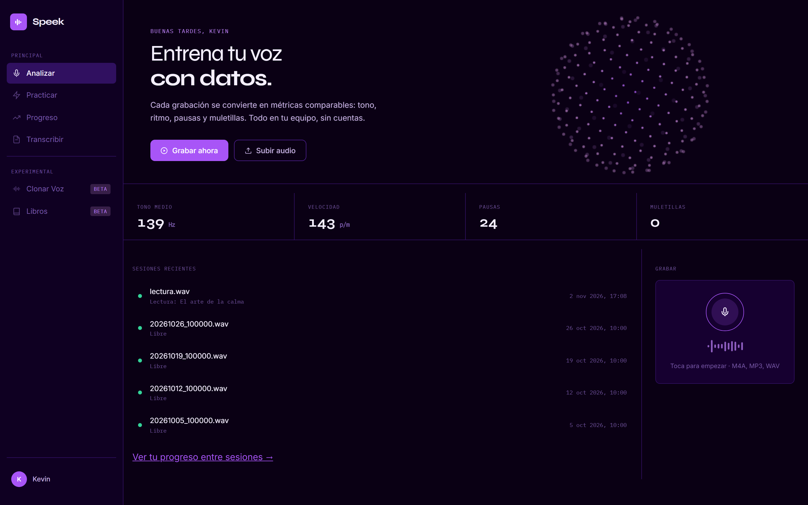
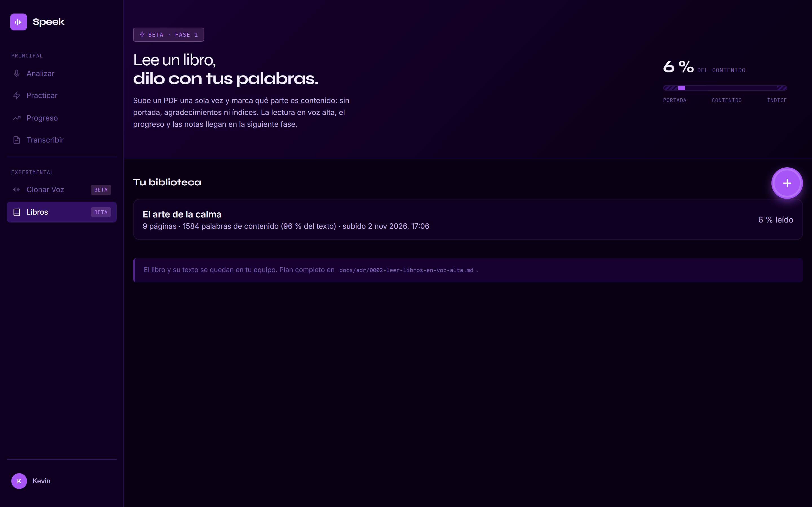
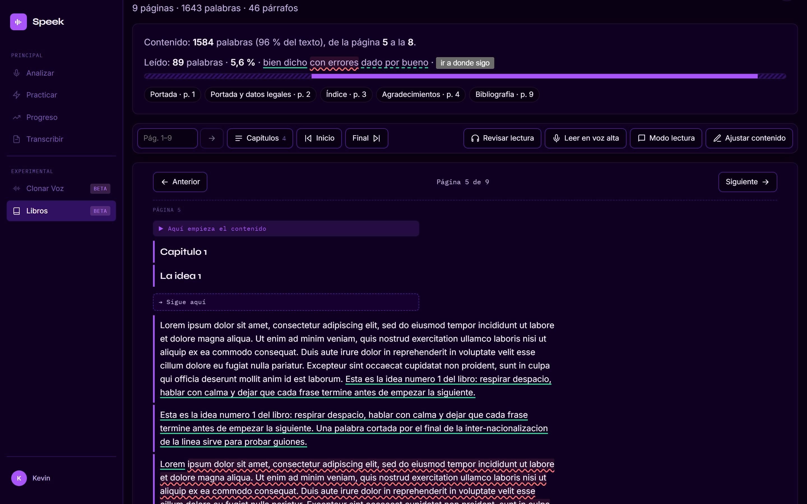

# 🎙️ Speek control — Entrena tu voz con datos

> Herramienta que analiza una grabación de voz y mide **tono, ritmo, pausas y muletillas**, para
> comparar tu progreso sesión a sesión. **Todo se procesa en local: el audio no sale del equipo.**

`Python` · `FastAPI` · `faster-whisper` · `Praat` · `pypdf` · `React 19` · `TypeScript` · `uPlot` · `SQLite`

> **Problem:** People who want to speak better judge themselves by ear, and apps that measure voice upload recordings to the cloud.  
> **Solution:** Speek turns a recording into comparable metrics (pitch, pace, pauses, filler words) and trains you against them, 100% locally. It also lets you read books aloud and tracks what you really said.  
> **Stack:** Python, FastAPI, faster-whisper, Praat, pypdf, React 19, TypeScript, SQLite.  
> **Live demo:** None (runs locally; a walkthrough is available on request).  
> **My role:** Solo project, end to end: audio analysis, API, UI and tests, working with an AI assistant under written conventions.

*Capturas tomadas con datos de ejemplo: una grabación de voz sintética y un PDF de prueba. No hay voces, libros ni datos reales.*

---

## El problema
Quien quiere hablar mejor (presentaciones, entrevistas, clases) suele guiarse por cómo se escucha, y
eso engaña: no hay forma de saber si hablas más rápido que hace un mes o si tu tono se ha vuelto más
plano. Las apps que lo miden suben el audio a la nube, y una grabación de tu voz es un dato personal.

## La solución
Speek convierte una grabación en métricas comparables y te hace practicar contra ellas:

- **📊 Informe por grabación:** tono medio, rango habitual, variación en semitonos, palabras por
  minuto, pausas y muletillas, con recomendaciones. Al tocar una gráfica o una palabra, el audio
  salta a ese momento.
- **📈 Progreso:** la última sesión frente a tu promedio, una gráfica por métrica y metas propias.
- **🏋️ Práctica guiada:** ejercicios de lectura, entonación, dicción y habla libre, para repetir el
  mismo contenido y comparar de forma justa.
- **⏱️ Retos con marcador en vivo:** sin silencios largos, sin monotonía, velocidad justa, sin
  muletillas (con transcripción en vivo) y explicar un texto de memoria.
- **📝 Transcribir en lote:** varios audios a la vez, exportables a `.txt`, `.srt` o un `.zip`.
- **📚 Libros (beta):** subes un PDF, marcas qué parte es contenido y lo lees en voz alta por tramos.
  Speek alinea tu lectura con el texto y calcula **qué leíste de verdad**, con modo estricto y revisión
  escuchando el audio de cada palabra dudosa.
- **🖥️ Un icono del escritorio** arranca el servidor y abre el navegador: un clic, sin terminal.

## Capturas

| | |
|---|---|
|  |  |
| *La biblioteca, con el avance de cada libro.* | *Lo leído se marca en el texto: bien dicho, con errores o dado por bueno.* |
|  |  |
| *Tono, pausas y velocidad sincronizados con el audio.* | *Transcripción tocable y exportable.* |

 El icono del escritorio.

## Decisiones técnicas destacadas
- **Todo local por diseño.** Praat (vía `parselmouth`) para el tono y faster-whisper en CPU para la
  transcripción: sin GPU, sin servicios externos y sin cuentas. FFmpeg no hace falta (PyAV).
- **Transcripción en vivo con dos vueltas.** Un WebSocket manda el audio al servidor, que transcribe
  con un modelo más liviano; las palabras salen en gris y se confirman a los 3–4 s. Hay guardas
  contra el texto inventado que Whisper produce con ruido de fondo.
- **Comparabilidad antes que cantidad de métricas.** Los ejercicios fijos, la marca de «grabación con
  ruido de fondo» y el filtro por tipo de ejercicio existen para que dos sesiones se puedan comparar
  de verdad.
- **Modelo de lenguaje intercambiable.** El reto de memoria lo evalúa Ollama (privado, gratis, 2–3
  minutos en un portátil sin GPU) o la API de Claude (segundos, centavos de dólar); solo viaja el
  texto de la explicación, nunca el audio. Se cambia en un `.env` sin reiniciar. En pruebas, los
  modelos pequeños daban por dichas ideas que faltaban, así que no se recomiendan para evaluar.
- **El progreso de un libro es la unión de lo que dijiste, no un marcador.** Cada lectura se alinea con el
  texto desde el párrafo de inicio (bloques de varias palabras, huecos tolerados) y los tramos se suman.
  Así el porcentaje refleja lo leído de verdad aunque saltes de capítulo o repitas. Las palabras que el
  PDF parte por dentro se reparan al extraer, y los términos técnicos se apoyan en un glosario del tramo.
- **Un lanzador que no se pelea con el puerto.** El icono reutiliza el servidor si ya corre; si no, busca
  el primer puerto libre desde el 8000 y recompila la interfaz solo si cambió.
- **Formatos reconocidos por contenido,** no por extensión (el celular entrega `.aac`, `.ogg`,
  `.m4a`…), con la fecha de grabación sacada del nombre del archivo o de sus metadatos.
- **HTTPS local para grabar desde el celular,** porque el navegador solo da el micrófono en contextos
  seguros; con respaldo de copiado donde no hay portapapeles seguro.

## Números del repositorio
216 pruebas automatizadas (API, formatos de audio, métricas, retos, extracción de PDF y alineación de lecturas). Desarrollado del 16 de septiembre al 1 de noviembre de 2026.

Rendimiento medido a mano en un portátil de 8 núcleos sin GPU, modelo `small`: un audio de 7 min 31 s
con ruido se transcribe en 100–115 s (~4× más rápido que el tiempo real).

## Resultado
Producto funcional de punta a punta, de uso personal: fases 0 a 6 completadas (motor, interfaz web,
historial, práctica, retos y transcripción en vivo, reto de memoria), el transcriptor en lote, un
rediseño visual, el icono del escritorio y la sección Libros (cargar el PDF, leer en voz alta con
progreso real, modo estricto y revisión con audio).

**Lo que falta, dicho claro:** de los libros, las notas por tramo y explicar en voz alta lo leído. La
página «Clonar Voz» existe solo como interfaz: todavía no hace nada. Pendientes: estructura narrativa
(historias y chistes) y constancia (rachas, insignias).

## Mi rol
Proyecto personal, hecho por mí de principio a fin: análisis de audio, API, interfaz, pruebas y
decisiones de diseño, trabajando con un asistente de IA bajo convenciones y pruebas escritas.

---

> 🔒 **Código fuente privado.** Este repositorio es solo el *case study*. Puedo mostrar el código y
> la app funcionando en una entrevista técnica.

**Contacto:** [GitHub](https://github.com/KevinHGitCode) · [LinkedIn](https://www.linkedin.com/in/kevin-diaz-garcia-846999240/) · [Instagram](https://www.instagram.com/kevin.hdiaz/) · kevinhafiddiazgarcia@gmail.com

© 2026 Kevin Díaz. All rights reserved. Text and screenshots may not be reused without permission.
